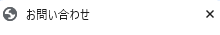
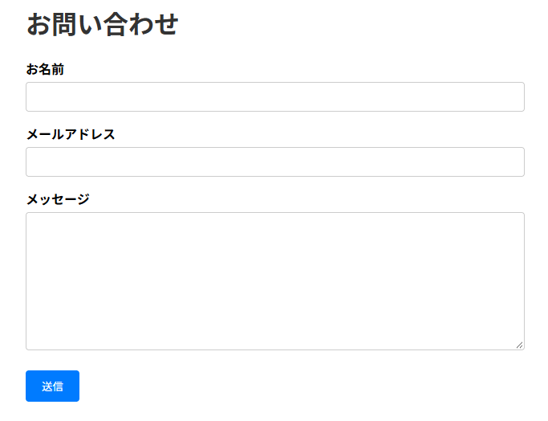
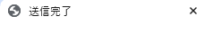
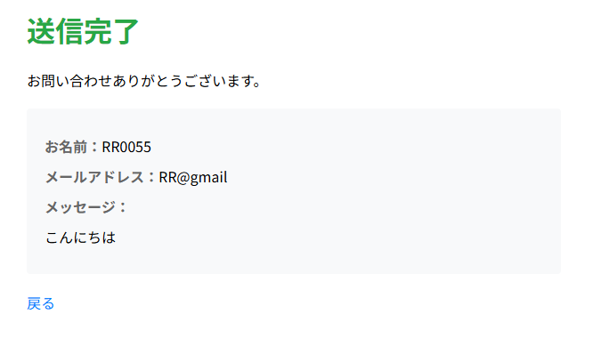
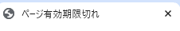
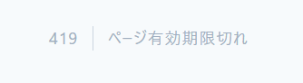
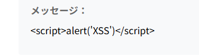

# security-app-practice

## 概要
COACHTECH 教材 Tutorial 10-6「Webセキュリティ ハンズオン」で作成した成果物です。

CSRF保護付きお問い合わせフォームを作成した。

## 使用技術

PHP 8.5.12 
Laravel 10.x 
CSRF 保護（`@csrf`）、XSS 対策（Blade の自動エスケープ）

## 学んだこと

・攻撃の種類、防ぐ方法など、頭では理解出来たつもりでも、 
コードを書くとなると何から書いたらいいのかわからない。 
・今世間でセキュリティの脆弱性などがあるが、 
自分でこうやってセキュリティの高いコードを書いていけるのか不安であり、 
面白そうだなと思うところもある。

## 動作確認

ブラウザを開いて確認した。 

 
 
 
 
 
 
